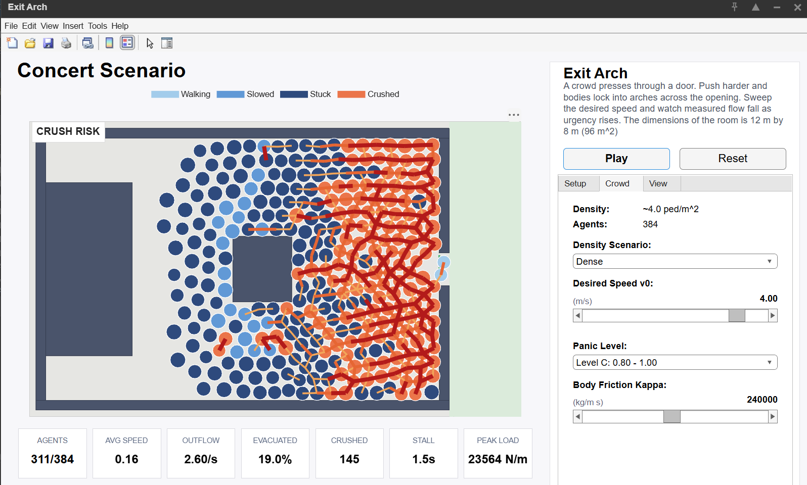
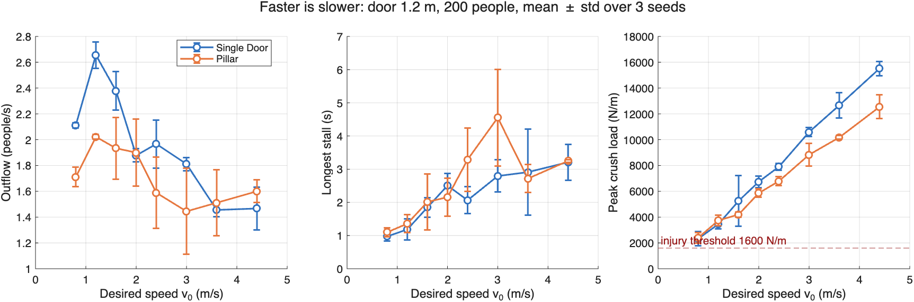

# Exit Arch (MATLAB)

A MATLAB crowd evacuation simulation adapted from the "Exit Arch" simulation at [Simulate It Now](https://simulateitnow.com/sim/exitArch) for concert venue evacuation scenarios (`12 m × 8 m = 96 m²`).
A crowd presses through a door. When people push harder, their bodies lock into arches across
the opening and the measured outflow drops even though everyone is trying to go faster.
This is the "faster is slower" effect.

The code implements the social-force model of
Helbing, Farkas & Vicsek, *Simulating dynamical features of escape panic*, Nature 407 (2000).



## Files

| File | What it does |
|------|--------------|
| `exitArchApp.m`    | Interactive window: play/pause, layouts, concert geometry, sliders, overlays, live readouts |
| `exitArchParams.m` | All parameters and their defaults |
| `exitArchInit.m`   | Builds the 12 m × 8 m room for the chosen layout and places the crowd |
| `exitArchStep.m`   | One time step of the physics, exits, loads and status |
| `exitArchRun.m`    | Headless run that returns metrics over time and a summary |
| `exitArchSweep.m`  | Sweeps desired speed `v0Max` across layouts & densities and saves `results/exitArchSweep.{csv,png}` |
| `Visualizations.m` | Runs all 9 `(density × panic)` evacuation combos and saves time-series, heatmap, and summary figures |
| `exitArchPlace.m`  | Finds an overlap-free spot for a new person |

## How to run

```matlab
cd ExitArch
exitArchApp              % interactive simulation
exitArchSweep            % faster-is-slower sweep across layouts & densities
Visualizations           % 9-scenario evacuation benchmark (saves figures/*.png)

% one headless run
P = exitArchParams('layout', 'Pillar', 'densityScenario', 'Dense', ...
                   'panicLevel', 'Level B', 'v0Max', 2.4, 'seed', 1);
R = exitArchRun(P, 300);
R.summary                % flow, longestStall, peakLoad, crushedAgents, evacTime, ...
plot(R.series.t, R.series.outflow)
```

## Controls

- **Setup**
  - **Layout:** Single Door, Pillar (a column in front of the door), Twin Doors, or Funnel.
  - **Door Width** (default `1.00 m`) and **Pillar Distance** (door to pillar centre, default `1.30 m`).
  - **Concert Scenario (stage):** Adds the performance stage along the left wall.
  - **Central Obstacle:** Adds a central obstruction in the room.
- **Crowd**
  - **Density Scenario:** Sets the initial crowd size in the `12 m × 8 m` room — **Baseline** (`288` agents, `~3.0 ped/m²`), **Dense** (`384` agents, `~4.0 ped/m²`), or **High Density** (`460` agents, `~5.0 ped/m²`).
  - **Desired Speed `v0`:** Upper bound of free-flow desired speed (`0.80` to `3.00 m/s`, default `1.80 m/s`).
  - **Panic Level:** Sets the individual panic distribution independently of crowd density — **Level A** (`0.00–0.49`), **Level B** (`0.50–0.79`), or **Level C** (`0.80–1.00`).
  - **Body Friction `κ`:** Tangential sliding friction (`0` to `500,000 kg/(m·s)`, default `2.4e5`).
- **View**
  - **Time Scale:** Simulation playback speed (`0.25×` to `4.00×`).
  - **Overlay:** Force Chains (`>200 N`, `>600 N`, `>1200 N`) or None.
  - **Density:** None or smoothed spatial Heatmap (`0` to `6+ ped/m²`).

All runs use an **Evacuation** scenario: agents spawn at $t = 0$ and exit without respawning until the room empties. Changing geometry, density, `v0`, or panic level resets the run; `κ` and View options apply live.

People are coloured **Walking** (at least half of mean `v0`), **Slowed**, **Stuck** (below 10% of mean `v0`),
or **Crushed** (compression load above `1600 N/m`).

The 7 cards under the room show live readouts:
- **Agents:** Remaining / initial agents in the room.
- **Avg Speed:** Mean instantaneous speed (`m/s`) of remaining agents.
- **Outflow:** People exiting per second over a `5 s` sliding window.
- **Evacuated:** Percentage of the initial crowd that has exited.
- **Crushed:** Number of agents currently experiencing compression loads `> 1600 N/m`.
- **Stall:** Longest gap (`s`) between consecutive exits.
- **Peak Load:** Highest circumference-normalized compression load (`N/m`) recorded in the run.

## The model

Each person is a disc with radius `0.20` to `0.24 m` and mass `80 kg` inside a `12 m × 8 m` room:

```
m dv_i/dt = m (v0_i e_i - v_i) / tau_i                                 (wants to walk to the door)
          + sum_j [ A exp((r_ij - d_ij)/B) + k g(r_ij - d_ij) ] n_ij   (keeps distance, body compression)
          + sum_j kappa g(r_ij - d_ij) (dv_ji . t_ij) t_ij            (sliding friction between bodies)
          + the same terms for walls, door jambs, stage, obstacle, and pillar
```

- `g(x) = max(x, 0)`, so the compression and friction terms only act when bodies touch.
- `A = 2000 N`, `B = 0.08 m`, `k = 1.2e5 kg/s²`, `κ = 2.4e5 kg/(m·s)` (Helbing et al., 2000).
- Individual relaxation time `τ_i = 0.5 p_i + 5.0 (1 - p_i)` scales with each agent's panic `p_i`, and panic introduces directional jitter around the desired exit vector `e_i`.
- `e_i` points at the closest point of the nearest door that the body fits through, steering around the central obstacle and pillar.
- Time step is `dt = 0.005 s` with semi-implicit Euler integration. The tangential friction coefficient is capped so the explicit step remains stable.
- **Crush load** is the radial body-compression force on a person (the `k g` terms only) divided by their circumference (`2 π r_i`). Above `1600 N/m` we mark them **Crushed** — a biomechanical compressive-asphyxia risk proxy rather than a fatality prediction.

Arches form because tangential friction (`κ`) lets compressed bodies lean on each other across the door opening. Higher desired speeds and panic press bodies harder into the arch, increasing stall durations and peak compression loads.

## Results & Visualizations

### 1. Desired Speed Sweep (`exitArchSweep.m`)

`exitArchSweep` sweeps `v0Max` (`0.8` to `3.6 m/s`) across `Single Door` and `Pillar` layouts for all three density scenarios (`Baseline`, `Dense`, `High Density`) at `Level B` panic (`3` seeds per point, up to `300 s` per evacuation run).



- **Single door vs. Pillar.** Increasing `v0Max` raises peak compression loads above the `1600 N/m` crush-risk threshold across all densities and increases arch-induced stalls. Placing a pillar `1.3 m` in front of the door disrupts direct radial force chains and reduces peak crush loads at high desired speeds, at the trade-off of slightly lower free-flow outflow.
- The raw sweep data is saved in `results/exitArchSweep.csv`.

### 2. 9-Scenario Evacuation Benchmark (`Visualizations.m`)

`Visualizations` runs a fixed-seed (`seed = 42`) factorial benchmark across all 3 density scenarios (`Baseline`, `Dense`, `High Density`) and all 3 panic levels (`Level A`, `Level B`, `Level C`) using the default `Single Door` concert layout (`1.00 m` door, `simTime = 300 s`, stopping early once the room empties) and exports three figures to `figures/` using an Okabe-Ito colorblind-safe palette:

- **`figures/exitarch_timeseries.png`:** A `4 × 3` grid tracking **Avg Speed** (`m/s`), **Evacuated** (cumulative count), **Crushed (live)** (agent count), and **Peak Load** (`N/m`) over time across all 9 combinations.
- **`figures/exitarch_heatmaps.png`:** Spatial `1 m × 1 m` heatmaps at highest panic (`Level C`) showing peak crowd density (`agents/cell`) and peak circumference-normalized compression (`N/m`) accumulated over the entire evacuation, overlaid with the stage, central obstacle, and exit location.
- **`figures/exitarch_summary.png`:** Grouped bar charts comparing total **Evacuation Time (`s`)**, **Total Ever Crushed** (unique agents exposed to `> 1600 N/m`), and **Peak Load (`N/m`)** across all 9 `(density × panic)` pairs.

## Differences from the original web simulation

- 2D top-down view with concert hall geometry (stage and central obstacle) instead of the 3D render.
- Independent **Density Scenario** (`288 / 384 / 460` agents) and **Panic Level** (`Level A / B / C`) controls in a fixed `12 m × 8 m` Evacuation setup rather than Steady Stream respawning.
- Sliders and readouts use physical SI units (`m/s`, `kg/(m·s)`, `N/m`) directly for quantitative analysis and reporting.